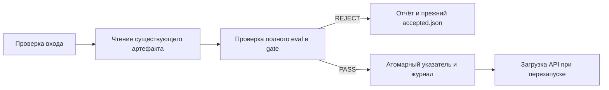

# ДЗ 8–10. Выпуск модели и локальный API

## Статус

Подготовка без запуска. Код, тесты и команды ниже написаны; их успешная работа
пока не подтверждена. Окружение и `uv.lock` предстоит собрать. Новых логов,
измерений, ответов модели и видео пока нет. Числа в разделе о ДЗ 6–7 относятся
к сохранённой предыдущей работе.

## 1. Исходники и окружение

Исходный прототип сохранён отдельным commit `7204896`. Исходные 13 тестов
в `tests/test_release.py` не редактировались. Файлы предыдущего проекта,
включая его тесты, сохранены в `previous/hw67`; commit и хеши —
`previous/source.json`.

Целевое устройство — MacBook Air M2, 16 ГБ. Настоящая генерация сохраняет
режим предыдущей оценки: CPU, float32, 4 потока. Python 3.12. Прямые версии
зависимостей зафиксированы в `pyproject.toml`. Установка и разрешение
транзитивных зависимостей отложены.

Семь причин и регрессионные тесты перечислены в `defects.csv`.
Предстоящие доказательства: `make prove`, `make check`, `make break-demo`.
В `evidence/regressions/` после запуска появятся красный/зелёный журналы,
JSON с результатами каждого теста и diff исправлений. Пока этих результатов нет.

## 2. Что переиспользуется из ДЗ 6–7

| Объект | Значение |
|---|---|
| Предыдущая сдача | `https://github.com/aralmi/mlops26-hw6-7` |
| Commit | `0a418163bda72af822792e72d4a40883d522fb92` |
| Training run выбранного кандидата | `1efd3e7eeda54bfc9ee161cf28065807` |
| Кандидат | `models:/pandas-qwen-adapter/1` |
| Evaluation run | `136e937e3f4a47cbbcc820f505159d2e` |
| Baseline | `Qwen/Qwen3-0.6B` |
| Revision базы | `c1899de289a04d12100db370d81485cdf75e47ca` |
| Golden / behavioral | 50 / 3 примера |
| Accuracy baseline / candidate | 0.40 / 0.22 |
| Критический срез indexing | 5/10 / 1/10 |
| Behavioral baseline / candidate | 1/3 / 2/3 |
| Решение предыдущего gate | REJECT; baseline остаётся опорной версией |

Нового sweep и обучения не требуется. `scripts/fetch_candidate.py` получает
готовый результат training run. `lineage.py` проверяет исходные файлы,
пересчитывает метрики из сырых ответов и вызывает тот же `quality_gate`.
Один `val_loss` не является допуском к выпуску.

Важное различие: baseline тоже не выполняет все behavioral-условия нового
кандидата. Поэтому импорт прежней baseline не создаёт фиктивный quality PASS.
Это отдельная операция восстановления уже закреплённой опорной версии;
`baseline-import.json` содержит происхождение и `quality_passed: false`.
Такой импорт не разрешает принять другую базу, адаптер или изменённый runtime.

## 3. Процесс и кеш

Четыре задачи в `flow.py` передают URI, ID и хеши. Веса и тензоры не входят
в результаты задач. Стадия подготовки действительно читает JSONL, проверяет
уникальные непустые ID и текст, сохраняет нормализованный результат на диск.
Она проверяет схему, а не выполняет обучение или новую токенизацию.

Ключ: SHA-256 канонического JSON `{data_sha256, config}`. В конфигурации
закреплены tokenizer revision/hash, шаблон, лимит длины и SHA-256 кода
подготовки вместе с используемым `release.py`. При запуске версия кода
вычисляется заново, поэтому старый config не скрывает изменение обработки.
Путь и mtime не заменяют содержимое. Prefect хранит результат задачи
в `.prefect/results`; сам подготовленный JSONL — в рабочем каталоге.

`attempts.jsonl` фиксирует `PREPARED`, `CACHE_HIT`, состояние задачи Prefect,
отказы и публикации. Идентичность попытки — случайный attempt ID;
идентичность результата — ключ содержимого. Путь workspace дополнительно
включён в Prefect-ключ, чтобы результат не ссылался на чужой временный каталог.

`make process-demo` должен показать сбой после подготовки, повтор в новом
процессе с кешем, изменение байтов по тому же пути и новый результат.
Отдельный workspace проверит сбой после обновления указателя и восстановление
журнала. Итоговые exit codes и записи будут в `evidence/process/`.

Если меняется сам golden, прежний полный eval становится несовместимым.
Новый кеш подготовки не делает старый отчёт качества пригодным для новых данных.

## 4. Допуск и безопасная запись

`validate_release` требует integer schema 1, непустые ID/URI, полный отчёт,
настоящий boolean `passed is True`, статус complete, evaluation run ID,
конечные accuracy/format_rate в [0, 1], совпадение четырёх хешей и model ID.
`runtime_sha256` считается заново из runtime.

Manifest закрепляет реальные файлы, точную базу, токенизатор и шаблон,
system prompt, greedy decoding, seed, thinking, лимит 32, CPU/float32 и версии
библиотек. Список файлов хешируется целиком. Перед публикацией и загрузкой
проверяются байты файлов, а базовый snapshot сравнивается с inventory.

Обвязка связывает решение с полными отчётами и сырыми ответами по SHA-256,
повторно считает все метрики и проверяет протокол/набор/модель. Перед самой
публикацией решение вычисляется повторно; ручное поле PASS недостаточно.
Изменённый runtime требует новой полной оценки.

`accepted.json` записывается через временный файл рядом с ним, flush/fsync,
`os.replace`. Отказ происходит до записи. При ошибке замены старые байты
сохраняются, временный файл удаляется. Конкуренция нескольких писателей
не поддерживается: по заданию писатель один.

Перед указателем сохраняется `release-intent.json`, затем атомарно обновляется
указатель и согласуется журнал. События индексированы по release ID;
JSONL для просмотра пересобирается атомарно. Повтор завершает незаконченный
журнал и не создаёт второго события того же выпуска. ID учитывает весь
manifest, runtime и связанное решение допуска. Попытки хранятся отдельно.

Управляемый откат берёт manifest и решение из истории принятия, повторно
проверяет файлы и публикует отдельное событие rollback. Сам по себе указатель
не означает смены модели в памяти API и не меняет Registry alias.

Сеть при экспорте повторяется не более двух раз после первого запроса и только
для временных ошибок. Неверная схема, веса, качество и публикация автоматически
не повторяются. Зафиксированный REJECT кандидату остаётся REJECT.

## 5. Быстрые проверки и триггеры

Предусмотрены 13 исходных тестов, 7 новых интеграций на каждом адаптере,
6 дополнительных проверок устойчивости и прежние 24 unit/integration теста
ДЗ 6–7. Из семи новых интеграций три обращаются к настоящему HTTP-серверу,
четыре выполняют выпуск через отдельные процессы и рабочие каталоги.

Красный прогон использует тот же файл тестов на исходном commit. Ошибки
импорта/неизвестной команды не засчитываются. Целевой зелёный прогон должен
использовать FastAPI и Prefect со stub; весов в нём нет.

| Изменение | Действие |
|---|---|
| Код процесса/API | `make check`; если изменились условия генерации — полный eval перед выпуском. Правка документации не требует обучения |
| Входные данные | Новый ключ подготовки; проверка схемы. При изменении golden/protocol — новый полный eval. Изменение train требует отдельно решить, нужен ли новый адаптер |
| Новый адаптер | Проверить файлы и загрузку, выполнить полный eval в контуре ДЗ 6–7, прежний gate, затем выпуск и перезапуск API |

Автоматизация локальная. `ci.example.yml` остаётся шаблоном; удалённые Actions
не запускались, обязательная проверка merge не настроена и не заявляется.

## 6. API

`GET /health` подтверждает жизнь процесса. `GET /ready` отвечает 503 до
загрузки нужных файлов и настоящего прогрева, затем 200 с ID и runtime hash.
Ошибка загрузки не превращается в готовность. Снимок manifest читается один раз.
Ответ генерации использует ID backend из памяти, а не текущий JSON на диске.

`POST /generate` принимает непустой prompt до 8000 символов; корпус запроса
ограничен 65536 байтами, модельный контекст — 4096 токенами с шаблоном.
Настоящий API принимает только лимит 32 из оценки, а не произвольные настройки.
Лёгкий stub допускает 1..32 для проверки исходного контракта. Неверный тип,
пустой текст, лишние поля и превышенный лимит отклоняются до генерации.

Вычисление одно за раз, одновременно допускается не более восьми запросов
в вычислении/очереди; переполнение получает 429. Ответ содержит `answer`,
`request_id`, `model_id`, `runtime_sha256`, фактическое `output_tokens`, время
вычисления, ожидания и полное серверное время. `/debug` есть только у stub.

Будущие доказательства: `make smoke` — реальный ответ, готовность и 422;
`make replay` — все 50+3 ответа baseline. `make versions-demo` проверит
A → публикация B без перезапуска → загрузка B → откат A → загрузка A.
Обе версии в этом опыте явно STUB ONLY, это не новое обучение и не новая
реально допущенная модель. Настоящая baseline проверяется отдельно.

## 7. Измерения

**Пока не выполнялись.** `scripts/benchmark.py` отправит одни и те же восемь
вопросов при параллельности 1 и 2 после прогрева, с лимитом 32. На медленном
CPU допускается `--n 4`, что будет явно записано как 4+4.

Каждая попытка сохраняется в JSONL: ID, режим, статус/ошибка, клиентское время,
время генерации и очереди, model ID, runtime hash, токены. Ошибки и тайм-ауты
не удаляются. Таблица CSV содержит n, успехи/ошибки, время пакета, успешные
запросы/с, среднюю и максимальную задержку успехов и отдельно ошибок.

Последовательный backend может увеличить ожидание при двух клиентах без
ускорения вычисления. Это гипотеза для будущего сравнения, не измеренный итог.
Среднее по восьми запросам не доказывает устойчивый p95.

Prefill обрабатывает весь prompt; decode последовательно строит новые токены.
KV-cache сохраняет ключи и значения внимания уже обработанных токенов;
его память растёт с длиной контекста и числом одновременно обслуживаемых
последовательностей. JSON возвращается целиком, поэтому TTFT и ITL здесь
не измеряются. Этот небольшой последовательный Transformers-сервис не
измеряет возможности планировщиков и continuous batching SGLang/vLLM.

## 8. Что предстоит перед сдачей

1. Собрать lock и окружение; пройти быстрые тесты, исправить найденные ошибки.
2. Получить настоящие красные/зелёные журналы и опыты кеша/сбоя/отката.
3. Проверить реальные артефакты, сохранить manifest и отказ с хешами указателя.
4. Проверить API baseline, перезапуск и совпадение ответов с eval.
5. Выполнить 8+8 или честные 4+4, заполнить таблицу фактическими числами.
6. Дополнить отчёт ссылкой на репозиторий и одним видео 5–8 минут.

В Git не включаются веса, `.venv`, рабочие каталоги, кеши, секреты и запись экрана.
Преподавателю доступны сохранённые данные/отчёты и публичная baseline по точной
ревизии; для загрузки адаптера нужен экспорт указанного run из локального MLflow.

## Источники по используемым библиотекам

- [Prefect task: persist_result, cache_key_fn, retries](https://github.com/PrefectHQ/prefect/blob/3.4.25/src/prefect/tasks.py).
- [FastAPI: загрузка ресурсов через lifespan](https://fastapi.tiangolo.com/advanced/events/).
- [Transformers: KV-cache](https://huggingface.co/docs/transformers/v4.57.1/en/cache_explanation).
